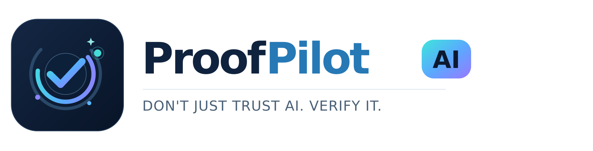
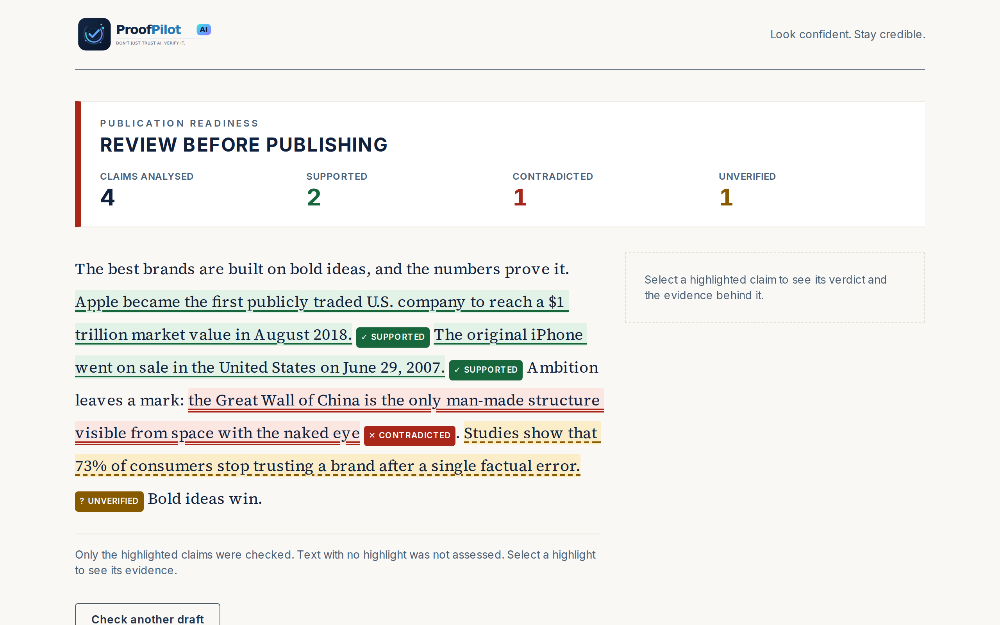
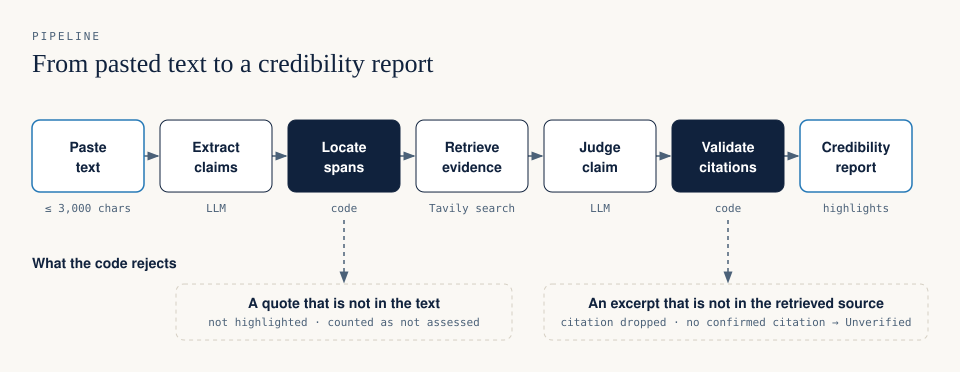
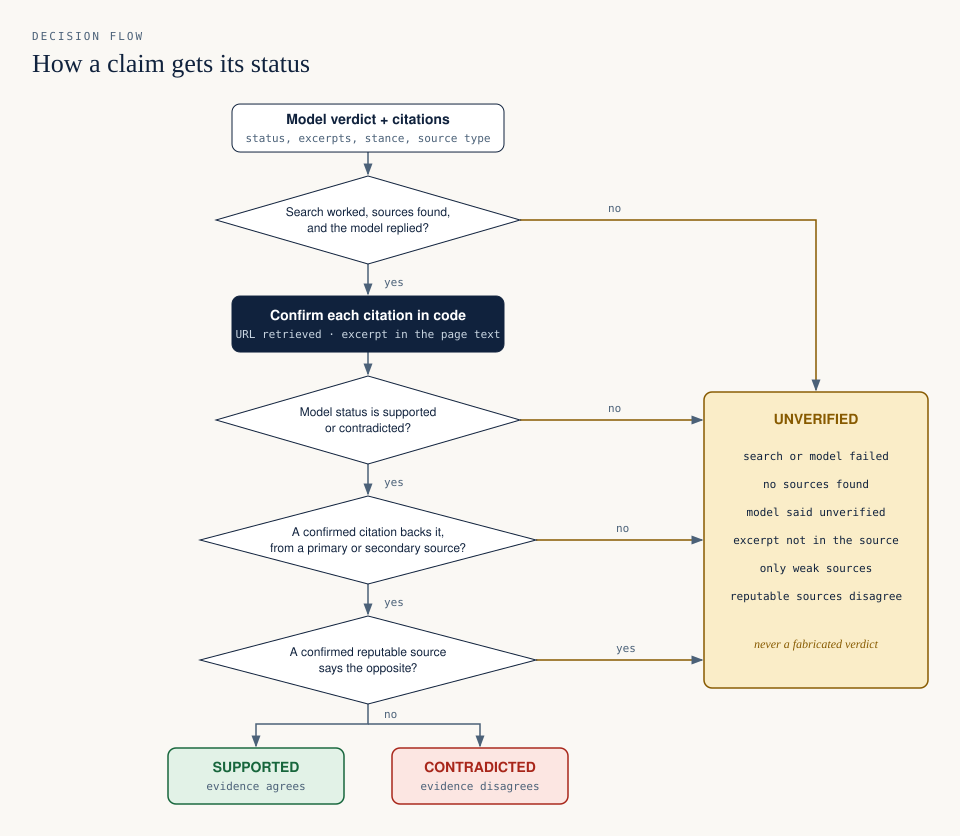
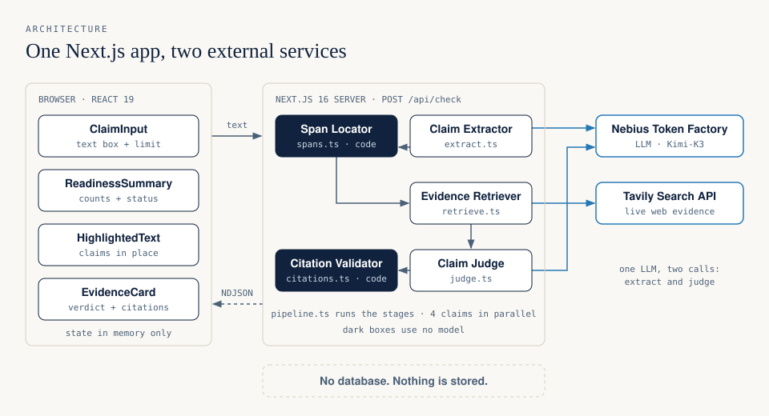
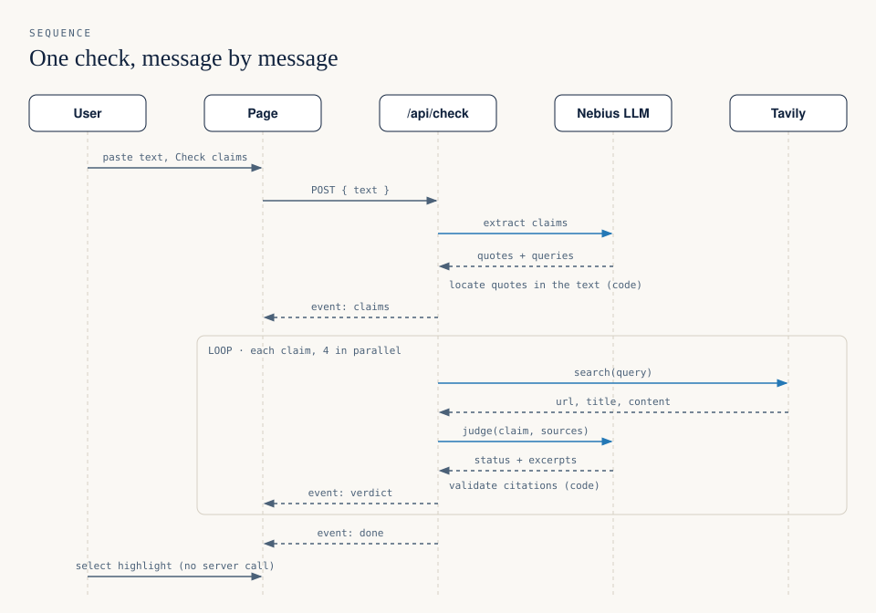
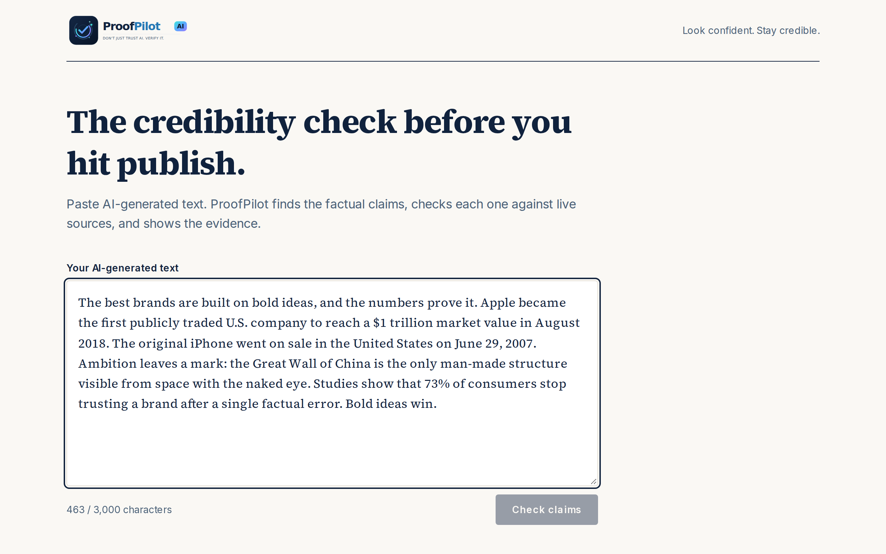
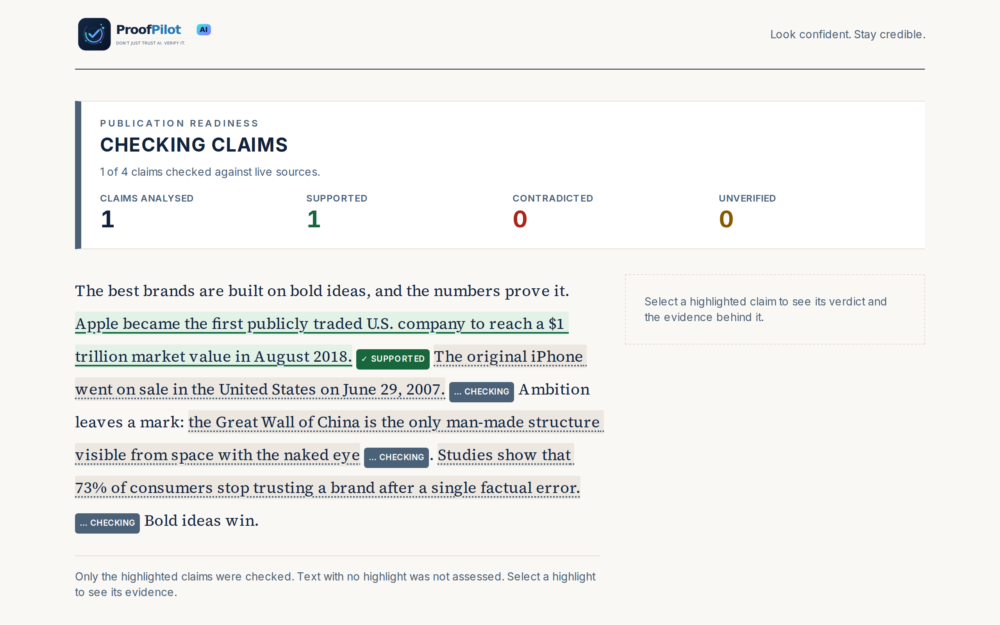
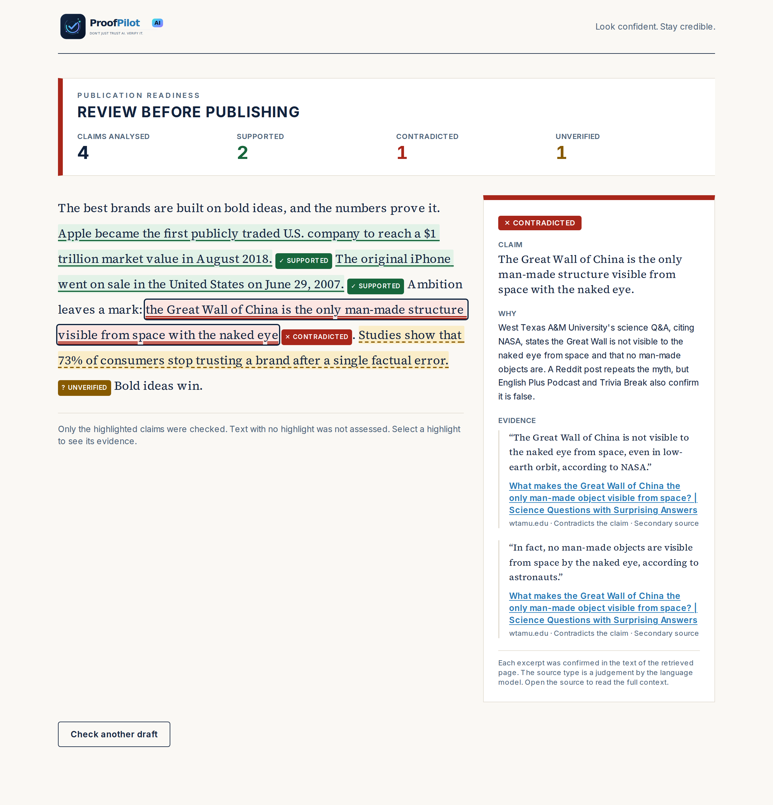

<p align="center">
  <picture>
    <source media="(prefers-color-scheme: dark)" srcset="public/brand/proofpilot_icon.svg" width="120">
    
  </picture>
</p>

<h3 align="center">Don't Just Trust AI. Verify It.</h3>

<p align="center">
  The credibility check before you hit publish.<br>
  Paste AI-generated text and see which factual claims real evidence supports.
</p>

---

AI can make you sound like an expert. ProofPilot helps ensure your claims survive fact-checking.

ProofPilot AI reads a draft, finds the factual claims, checks each claim against live web sources, and marks it in place as **Supported**, **Contradicted**, or **Unverified**. Each verdict shows the evidence behind it: a quotation, the page it came from, and a link.



> This screenshot is real output from the app. The paragraph is a sample draft that contains a common myth and a statistic with no source.

## The problem

AI writing tools produce confident, well-formed text. They also produce statistics, dates, and "research findings" that are wrong, and the wrong ones look the same as the correct ones.

A person who publishes that text puts their own name on it. The usual check is manual: copy a sentence into a search engine, open some pages, compare, repeat. It is slow, and it is easy to skip.

## The solution

ProofPilot answers one question before you publish: **will this text embarrass me when someone checks the facts?**

- It shows your original text, unchanged, with each checked claim highlighted.
- It does not ask you to trust it. Each verdict has a quotation and a link, so you can inspect the evidence.
- It says "Unverified" when the evidence is missing, weak, or in conflict. It does not guess.

## Key features

| Feature | What it does |
| --- | --- |
| **Inline claim highlighting** | Green, red, and amber highlights on your own text. Each status also has a label and its own underline style, so the status does not depend on colour. |
| **Publication readiness summary** | The number of claims analysed, supported, contradicted, and unverified, with one status: "Review before publishing" or "All checked claims supported". |
| **Evidence cards** | Select a claim to see the verdict, a short explanation, and the cited passages with links to the sources. |
| **Citations confirmed by code** | A citation is shown only if its excerpt is in the text of a page that the search returned. See [How ProofPilot works](#how-proofpilot-works). |
| **Honest coverage** | Only highlighted claims count as checked. The input limit is visible before a check, and a partial check gives a warning. |
| **Live results** | Verdicts arrive one by one as each claim completes. |

## How ProofPilot works

A language model does two jobs: it finds the claims, and it compares each claim with the retrieved sources. Plain code checks the model's work between the steps. The code does not trust the model.



The code enforces these rules:

1. **A claim must be an exact quotation of your text.** If the model returns words that are not in the text, the claim is not highlighted and is counted as "not assessed".
2. **A citation must come from a retrieved page.** The link and the title always come from the search result, never from the model.
3. **An excerpt must be in the page text.** If the excerpt is not in the retrieved content of its source, the citation is dropped.
4. **A verdict needs confirmed evidence.** "Supported" or "Contradicted" needs a minimum of one confirmed citation from a primary or secondary source. If there is none, the claim is Unverified.
5. **Sources that disagree give Unverified.** If confirmed citations from reputable sources point in opposite directions, the claim is Unverified.



## Architecture

One Next.js application. The page and one server route are in the same project. There is no database and no account system. A report exists only in the page's memory.



| Component | File | Purpose |
| --- | --- | --- |
| Check route | `src/app/api/check/route.ts` | Validates the input, runs the pipeline, and streams events as newline-delimited JSON. |
| Claim extractor | `src/lib/extract.ts` | Asks the model for claims as exact quotations, each with a search query. |
| Span locator | `src/lib/spans.ts` | Finds each quotation in the text by exact match. Code only. |
| Evidence retriever | `src/lib/retrieve.ts` | One Tavily search for each claim. |
| Claim judge | `src/lib/judge.ts` | Asks the model for a status, an explanation, and citations. |
| Citation validator | `src/lib/citations.ts` | Confirms each citation and applies the status rules. Code only. |
| Pipeline | `src/lib/pipeline.ts` | Connects the stages and checks four claims at a time. |
| Summary and report state | `src/lib/summary.ts`, `src/lib/report.ts` | The counts, the readiness status, and the state of the page. |

<details>
<summary>Sequence of one check</summary>



</details>

The diagrams follow the design system of [Diagram Design](https://github.com/cathrynlavery/diagram-design) and were exported with its `export_svg.py` script. The editable sources are in [`docs/diagrams/src/`](docs/diagrams/src/).

## Screenshots

| Paste a draft | Claims are checked live |
| --- | --- |
|  |  |

**Inspect the evidence for a claim**



All screenshots come from the running app with real services. None is edited.

## Technology stack

| Area | Technology |
| --- | --- |
| Application | [Next.js 16](https://nextjs.org) (App Router), React 19, TypeScript |
| Styling | [Tailwind CSS 4](https://tailwindcss.com) |
| Language model | [Nebius Token Factory](https://tokenfactory.nebius.com), an OpenAI-compatible API, through the [`openai`](https://github.com/openai/openai-node) package. Default model: `moonshotai/Kimi-K3`. |
| Structured output | Strict JSON schema, validated with [Zod](https://zod.dev) |
| Evidence retrieval | [Tavily Search API](https://tavily.com) through `@tavily/core` |
| Tests | [Vitest](https://vitest.dev) |

## Getting started

Requirements: Node.js 22 or later, [pnpm](https://pnpm.io), a Nebius Token Factory API key, and a Tavily API key.

```bash
git clone https://github.com/yablokolabs/proofpilot.git
cd proofpilot
pnpm install
cp .env.example .env
```

### Environment configuration

Put your keys in `.env`. Git ignores this file.

| Variable | Necessary | Purpose |
| --- | --- | --- |
| `NEBIUS_API_KEY` | Yes | Claim extraction and evidence evaluation. |
| `TAVILY_API_KEY` | Yes | Evidence retrieval. |
| `NEBIUS_MODEL` | No | A different Nebius model. The default is `moonshotai/Kimi-K3`. |

The keys are used on the server only. They are not sent to the browser.

### Running locally

```bash
pnpm dev
```

Open <http://localhost:3000>, paste a paragraph, and select **Check claims**.

For a production build:

```bash
pnpm build
pnpm start
```

## Testing

```bash
pnpm test        # unit tests
pnpm typecheck   # TypeScript
pnpm lint        # ESLint
```

The unit tests cover the logic that protects the integrity of a report: input limits, span location, citation validation, pipeline orchestration and failure handling, the readiness summary, the event stream reader, and the report state. They use no network.

To run the real pipeline from the command line, with real model and search calls:

```bash
pnpm check:live "The Eiffel Tower was completed in 1889. Humans only use 10% of their brains."
```

## Example verification workflow

1. Paste this draft:

   > The best brands are built on bold ideas, and the numbers prove it. Apple became the first publicly traded U.S. company to reach a $1 trillion market value in August 2018. The original iPhone went on sale in the United States on June 29, 2007. Ambition leaves a mark: the Great Wall of China is the only man-made structure visible from space with the naked eye. Studies show that 73% of consumers stop trusting a brand after a single factual error. Bold ideas win.

2. Select **Check claims**. The claims are highlighted, and the verdicts arrive one by one.
3. Read the summary. In our runs the status was "Review before publishing".
4. Select the claim about the Great Wall. The evidence card shows quotations that contradict it, with links.
5. Select the "73% of consumers" claim. It is Unverified, because the search found no reputable source for that number.

In three consecutive runs on 11 October 2026, this draft gave the same result each time: two claims supported, one contradicted, one unverified. Results can change, because the web and the model's output change.

## Limitations and responsible use

ProofPilot is a proof of concept. Use it to find claims that need a second look. Do not use it as proof that a text is correct.

- **It checks only the highlighted claims.** Text with no highlight was not assessed. The model can miss a claim.
- **Verdicts can be wrong and can vary between runs.** Retrieval and the model are not deterministic. During development, one contested claim received three different verdicts in three runs. The rule that disagreeing sources give Unverified was added for that reason.
- **"Supported" means that a retrieved source agrees.** It does not mean that the claim is true. The source can be wrong.
- **Source quality is a model judgement.** The code confirms that a quotation is in a retrieved page. It cannot confirm that the page is reputable. The model labels each source as primary, secondary, or other.
- **The evidence is the text that the search returned,** not the full page. Open the source and read the context.
- **Limits:** 3,000 characters and 8 claims for each check.
- **Privacy:** the text that you paste is sent to Nebius and Tavily for processing. Do not paste confidential text. ProofPilot stores nothing.
- **Model evaluation was small.** The default model was selected from real runs on two paragraphs with ten claims. See [`devpost/checklist.md`](devpost/checklist.md).

## Built for Build With AI: Basics

ProofPilot AI is an entry for the Devpost hackathon [Build With AI: Basics](https://learn-ai-basics.devpost.com/). It was built with the [Devpost Learn Skill Pack](https://github.com/challengepost/learn-ai-basics), which uses a plan-first process: scope, product requirements, technical spec, then a build in small verified steps. An AI coding agent (Claude Code) wrote the code under that process. The planning documents are in the repository:

| Document | Content |
| --- | --- |
| [`devpost/scope.md`](devpost/scope.md) | The idea, the user, and the boundary of the proof of concept. |
| [`devpost/prd.md`](devpost/prd.md) | What the product does, with acceptance criteria. |
| [`devpost/spec.md`](devpost/spec.md) | How it is built. |
| [`devpost/checklist.md`](devpost/checklist.md) | The build steps, and each change to the plan with its reason. |

## Demo video

The demo video is at [`demo/proofpilot-demo.mp4`](demo/proofpilot-demo.mp4). The script and the storyboard are in [`demo/`](demo/).
